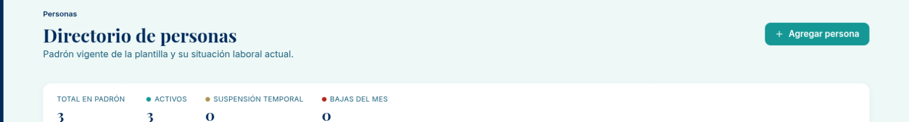
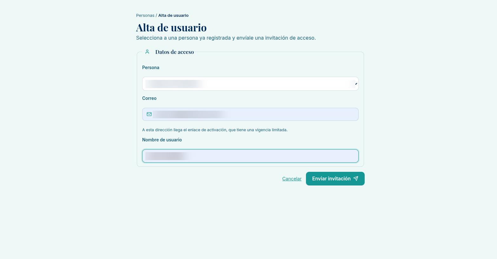
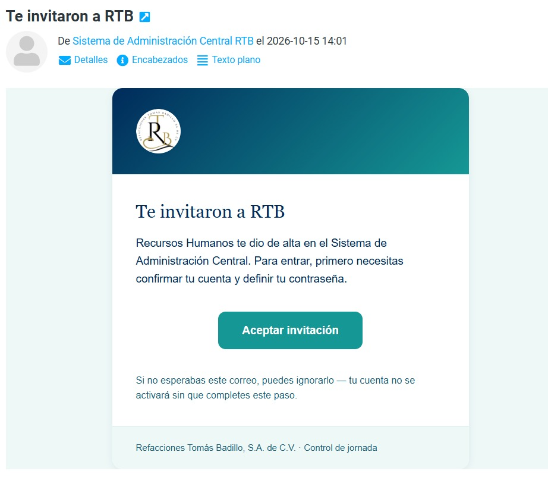
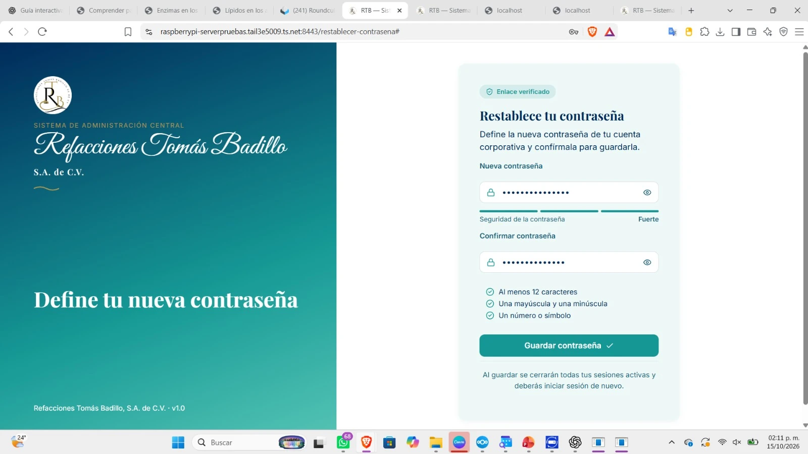
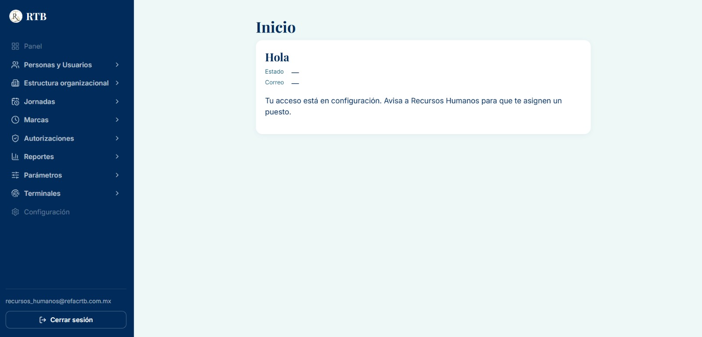

# Guía: dar de alta a una persona y crear su acceso al sistema

**Para:** Recursos Humanos. **Sistema:** RTB Sistema de Administración Central. **Estado:** BORRADOR v0.1 (16 de octubre de 2026), probado de
punta a punta con una persona real en la base de pruebas.

Esta guía cubre dos pasos que se hacen uno detrás del otro: (1) **registrar a la persona** con su expediente y (2) **crearle su acceso**
para que entre al sistema. La huella en la terminal de checado es **otra guía** (la hacen TI y RH juntos frente a la terminal).

## Antes de empezar

- Necesitas el permiso **«alta de personas y usuarios»**. Si no lo tienes, al enviar verás «No tienes permiso para dar de alta personas.»
- Ten a la mano: nombre completo, fecha de nacimiento, CURP, RFC, NSS, fecha de ingreso, tipo de contrato, el **folio del expediente
  físico** y el **correo** al que llegará la invitación.
- **El folio no se inventa.** Es el consecutivo real del folder físico, con el formato `RTB-RH-EIT-AAAA-N` (por ejemplo
  `RTB-RH-EIT-2026-06`): `AAAA` es el año y `N` el número que toca. Dos personas no pueden tener el mismo folio.
- Una alta con datos reales **no se puede borrar después** (el historial del sistema es inmutable). Revisa antes de enviar.

## Paso 1. Registrar a la persona

1. En el menú lateral entra a **Personas y Usuarios → Directorio** y pulsa **«+ Agregar persona»** (arriba a la derecha).

   

2. Se abre **«Alta de persona»**. Llena los tres bloques:

   | Bloque | Campo | Obligatorio | Nota |
   |---|---|---|---|
   | Datos personales | Primer nombre, Apellido paterno | Sí | El segundo nombre y el apellido materno son opcionales |
   | | Fecha de nacimiento | Sí | |
   | | CURP | Sí | 18 caracteres; el sistema la pone en mayúsculas |
   | | RFC | Sí | 13 caracteres con homoclave; en mayúsculas |
   | | NSS | Sí | 11 dígitos |
   | Alta laboral | Fecha de ingreso | Sí | |
   | | Tipo de contrato | Sí | Indefinido, Prestación de servicios o Por proyecto |
   | Referencia de expediente | Folio (`documento_ref`) | Sí | Formato `RTB-RH-EIT-AAAA-N` |

3. Pulsa **«Registrar alta»** **una sola vez** y espera. Si todo sale bien, el sistema te lleva a la **ficha** de la persona. No hay
   mensaje de «guardado»: llegar a la ficha es la confirmación.

> **Si algo no cuadra**, el sistema te lo dice en rojo debajo del formulario y no crea nada:
> - «Ya existe una persona registrada con esa CURP / ese RFC / ese NSS.» → la persona ya está registrada; búscala en el Directorio.
> - «Ese folio de expediente ya está en uso por otra persona.» → revisa el consecutivo del folder.
> - «El folio del expediente debe tener el formato RTB-RH-EIT-<año>-<número>» → corrige el folio.
>
> El alta es **todo o nada**: si falla algo, no queda una persona a medias.

## Paso 2. Crear su acceso al sistema

1. En la ficha de la persona pulsa **«Crear acceso al sistema»** (aparece solo si todavía no tiene acceso).
2. Se abre **«Alta de usuario»** con la persona ya seleccionada. Escribe:
   - **Correo:** a esa dirección llegará el enlace de activación (con vigencia limitada).
   - **Nombre de usuario:** el que usará en el sistema.
   

3. Pulsa **«Enviar invitación»** **una sola vez**. Debe aparecer **«Invitación enviada.»**

> **Si falla:** «Esta persona ya tiene un usuario asociado.» (ya tenía acceso), «El correo no es válido o ya tiene una cuenta de acceso.»,
> «Se alcanzó el límite de envíos de invitación… reintenta en unos minutos.» o «No se pudo enviar la invitación…» (avisa a Sistemas).
> **No reintentes varias veces seguidas:** cada intento cuenta contra el límite de envíos.

> **El correo.** Si usas un buzón compartido (por ejemplo `recursos_humanos@…`), cualquiera con acceso a ese buzón podría activar o
> recuperar la cuenta. Para personas reales usa su **correo individual**.

## Paso 3. Lo que hace la persona invitada

1. Recibe el correo **«Te invitaron a RTB»** y pulsa **«Aceptar invitación»**. **El enlace es personal y de un solo uso: no lo
   reenvíes ni lo compartas.**

   

2. Llega a una pantalla para **definir su contraseña** (aunque el título diga «Restablece tu contraseña», es el mismo paso): mínimo
   12 caracteres, una mayúscula y una minúscula, y un número o símbolo. Pulsa **«Guardar contraseña»**.

   

3. **Verificación en dos pasos.** El sistema pide configurar una app autenticadora (Google Authenticator, Microsoft Authenticator o
   Authy): se escanea el código QR y se escribe el código de 6 dígitos. En la app aparecerá como **«RTB Administración Central»**.
   **El código QR y la clave manual son secretos: nunca los fotografíes ni los compartas.**
4. Inicia sesión. Si todavía **no tiene un puesto asignado**, aterriza en **Inicio** y ve solo su nombre, su estado y el mensaje
   «Tu acceso está en configuración. Avisa a Recursos Humanos para que te asignen un puesto.» **No ve la información de otras personas.**

   

## Paso 4. Verifica el resultado (RH)

- En la **ficha** de la persona, el botón «Crear acceso al sistema» ya no aparece.
- En el **Historial de estado** y en la **bitácora de movimientos** verás el movimiento **Alta**. Es normal que, entre el Paso 1 y el
  Paso 2, la ficha diga «Sin movimientos registrados todavía»: el movimiento de alta se registra cuando se crea el acceso.
- Para que la persona vea módulos del sistema, hay que **asignarle un puesto** (Estructura organizacional → Asignaciones).

## Preguntas frecuentes

- **No me llegó el correo.** Revisa spam; confirma el correo; si sigue sin llegar, avisa a Sistemas. No reenvíes la invitación varias
  veces seguidas.
- **El enlace dice que venció o ya no es válido.** Es de un solo uso (y algunos filtros de correo lo abren antes que la persona).
  Avisa a Sistemas para enviar una invitación nueva.
- **Me equivoqué de correo.** El correo vive solo en el acceso (no en la ficha). Avisa a Sistemas antes de volver a invitar.
- **Cuenta suspendida.** La reactivación solo la hace Recursos Humanos desde el movimiento de estado de la persona.
- **Huella en la terminal.** Otra guía (TI + RH), después de que la persona ya tenga su registro en el sistema.

## Qué NO hacer

- No uses datos de prueba con personas reales ni al revés: lo registrado no se borra.
- No compartas el enlace de invitación, el código QR ni los códigos de 6 dígitos; no los pegues en chats ni correos.
- No pulses «Registrar alta» ni «Enviar invitación» varias veces seguidas.
- No inventes un folio: pide el consecutivo al responsable del expediente físico.

---
*Pendiente de completar en esta guía:* capturas del formulario de alta de persona (vacío y lleno con datos de ejemplo o difuminados), de la
ficha recién creada y de «Invitación enviada.», y la pantalla de configurar el 2FA sin código QR ni clave.
