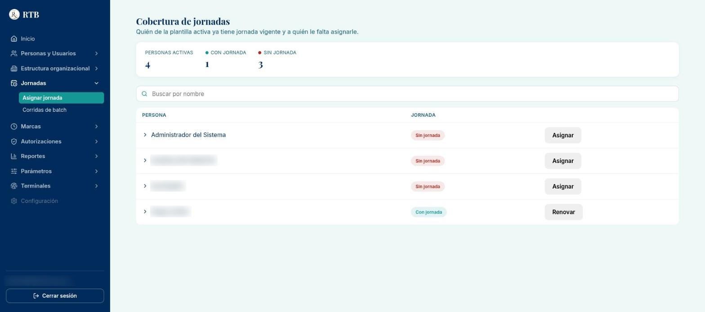
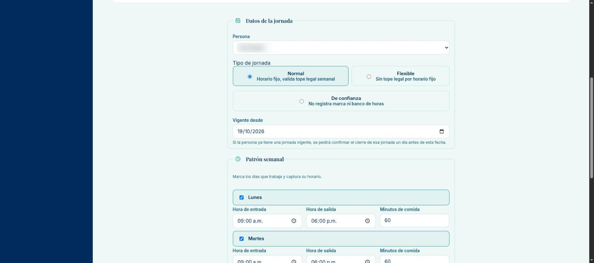
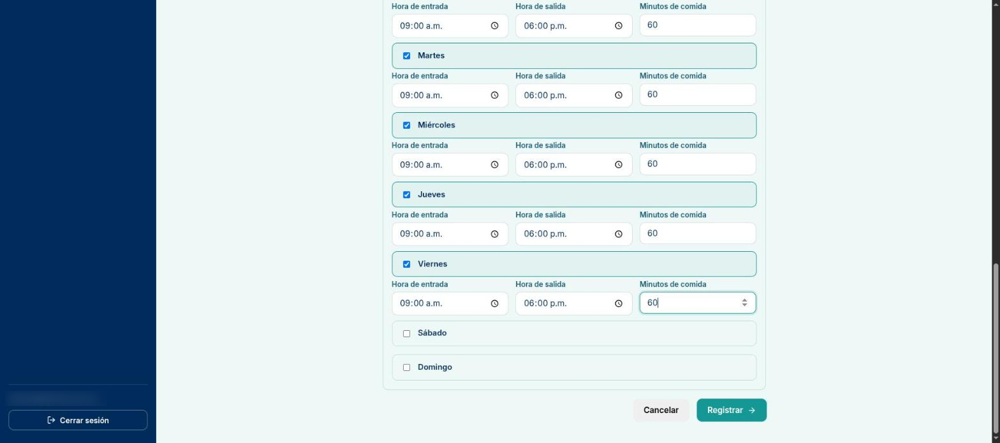
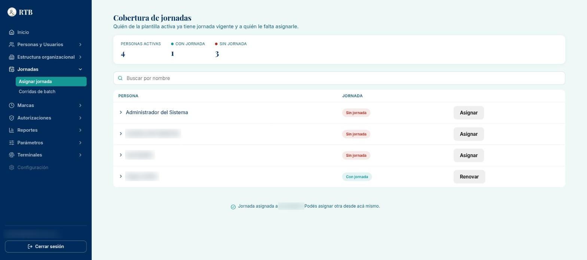
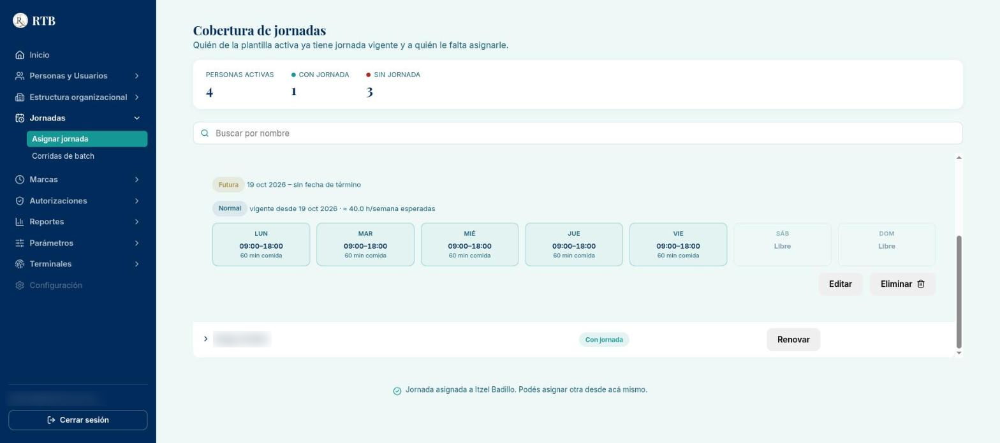
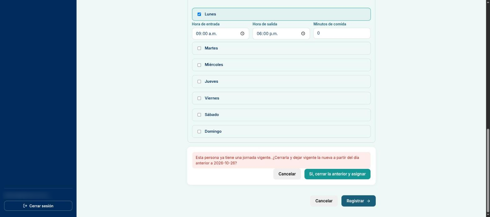
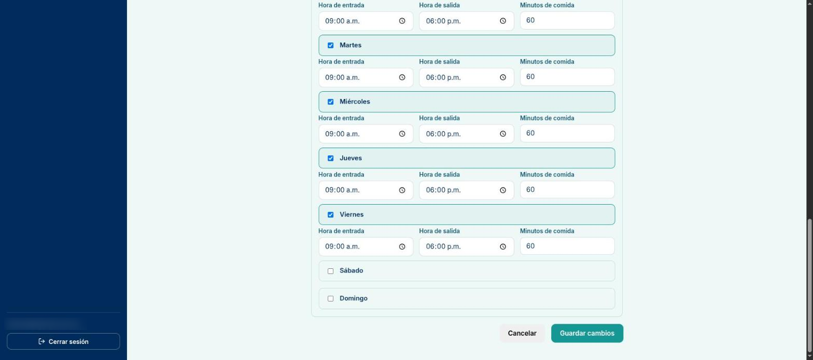
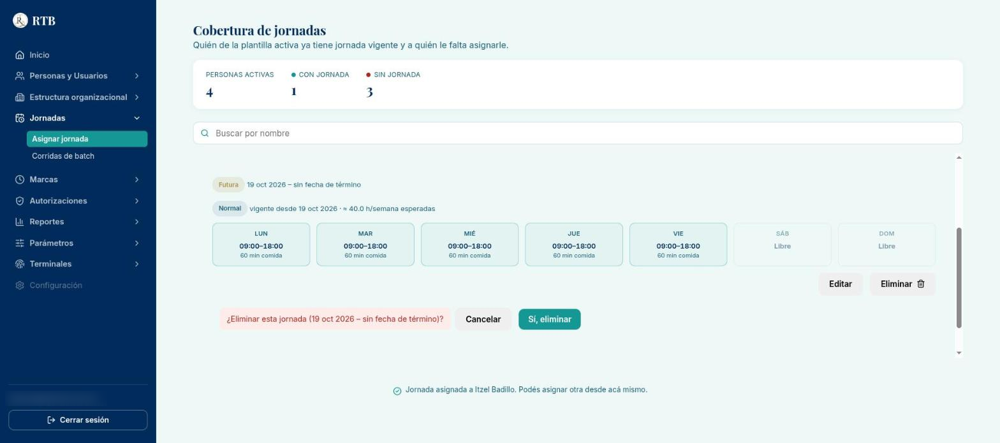

# Guía: asignar, renovar y corregir la jornada de una persona

**Para:** Recursos Humanos. **Sistema:** RTB Sistema de Administración Central. **Estado:** BORRADOR v0.1 (17 de octubre de 2026),
recorrido en la app de pruebas (primera jornada real: Responsable de Recursos Humanos, lunes a viernes de 9:00 a 18:00).

La **jornada** le dice al sistema qué días y en qué horario trabaja cada persona. Con ella el sistema sabe cuándo esperar sus marcas
en la terminal, detecta retardos y faltas, y calcula las horas del banco de horas. **Sin jornada, el sistema no espera nada de esa
persona.** Esta guía cubre: (1) asignar la primera jornada, (2) renovarla cuando cambia el horario y (3) corregir o eliminar una
jornada que todavía no empieza.

Va después de la guía de alta y de la de asignar puesto: la persona ya debe estar registrada y **activa**.

## Antes de empezar

- Necesitas los permisos de **edición de jornada** y de **edición del patrón semanal**. Hoy los tienen «Responsable de Recursos
  Humanos» y «Gerente General».
- Ten a la mano: el **tipo de jornada**, los **días** que trabaja, la **hora de entrada y salida** de cada día, los **minutos de
  comida** y la **fecha** desde la que aplica.
- **Elige bien la fecha de inicio.** Desde ese día el sistema espera las marcas de la persona. Si pones una fecha pasada, los días
  trabajables ya transcurridos sin marcas pueden aparecer como faltas o quedar pendientes para el corte quincenal. Lo más seguro es
  **hoy o una fecha futura** (por ejemplo, el próximo lunes). Si de verdad necesitas una fecha pasada, avisa antes a Sistemas.
- Los tres tipos de jornada:

  | Tipo | Cuándo se usa | Qué hace el sistema |
  |---|---|---|
  | Normal | Horario fijo | Espera sus marcas, cuenta retardos y valida que la suma semanal no pase del tope legal |
  | Flexible | Horario que se mueve | Espera sus marcas, sin validar el tope legal por horario fijo |
  | De confianza | Puestos sin checado | No registra marcas ni banco de horas |

## 1. Asignar la primera jornada

1. En el menú lateral entra a **Jornadas → Asignar jornada**. Arriba verás la **Cobertura de jornadas**: cuántas personas activas
   tienen jornada y cuántas no. Busca a la persona y pulsa **«Asignar»** en su fila.

   

2. Debajo de la tabla se abre el formulario con la persona ya elegida. En **Datos de la jornada** elige el **Tipo de jornada** y
   escribe la fecha en **Vigente desde**:

   

3. En **Patrón semanal**, marca cada día que trabaja. Al marcarlo aparecen sus campos: **Hora de entrada**, **Hora de salida** y
   **Minutos de comida**. Los días sin marcar quedan como «Libre».

   

4. Pulsa **«Registrar»** **una sola vez**. Debe aparecer el mensaje **«Jornada asignada a …»** debajo de la tabla.

   

> **Si la jornada empieza en una fecha futura, la persona sigue saliendo como «Sin jornada»** hasta ese día. Es normal: la
> cobertura cuenta solo las jornadas que ya están en curso. Para confirmar que quedó guardada, haz clic en el nombre de la persona.

5. Haz clic en el **nombre** de la persona para abrir su detalle. Verás cada jornada con su etiqueta (**Futura**, **En curso** o
   **Pasada**), las fechas, las horas semanales esperadas y el horario de cada día:

   

> **Si algo no cuadra**, el sistema lo dice en rojo y no guarda nada:
> - «La suma de horas semanales del patrón (… h) se pasa del tope legal vigente (… h).» → revisa horarios y minutos de comida
>   (solo aplica a jornada Normal).
> - «La nueva vigencia debe comenzar después de que empezó la jornada actual.» → la fecha nueva tiene que ser posterior al inicio
>   de la jornada que ya tiene.
> - «La persona no existe.» → revisa que la persona esté registrada y activa.

## 2. Renovar la jornada (cambio de horario)

Se usa cuando a una persona **le cambia el horario** a partir de cierta fecha. El sistema cierra la jornada actual **un día antes**
de la fecha nueva y abre la nueva; el historial de la anterior se conserva.

1. En la fila de la persona (dice «Con jornada») pulsa **«Renovar»**.
2. Llena el formulario igual que en el paso 1. **Ojo: el patrón semanal no se copia de la jornada anterior**; captura otra vez
   todos los días, aunque solo cambie uno.
3. Pulsa **«Registrar»**. Como la persona ya tiene una jornada vigente, el sistema pide confirmar el cierre:

   

4. Revisa la fecha y pulsa **«Sí, cerrar la anterior y asignar»**, o **«Cancelar»** si te equivocaste. Hasta que confirmes, no se
   cierra nada.

> **Ejemplo:** si la jornada nueva empieza el **26 de octubre**, la anterior termina el **25 de octubre**.

## 3. Corregir o eliminar una jornada que todavía no empieza

Mientras una jornada esté **Futura** y sea **la última planeada** de la persona, se puede corregir o eliminar. Una vez que empieza,
ya no: los botones aparecen deshabilitados y, al pasar el ratón, el sistema explica por qué. Para cambiar una jornada en curso se
**renueva** (paso 2).

**Editar.** En el detalle de la persona pulsa **«Editar»**. El formulario se abre con los datos de esa jornada (la persona no se
puede cambiar). Corrige lo necesario y pulsa **«Guardar cambios»**. Debe aparecer «Jornada de … actualizada.»

**Eliminar.** En el detalle pulsa **«Eliminar»**. El sistema pregunta antes de borrar. Si la persona tenía una jornada anterior,
también avisa que esa volverá a quedar sin fecha de término:

Pulsa **«Sí, eliminar»** solo si de verdad quieres borrarla. Con **«Cancelar»** no pasa nada.

> **Mover fecha de término.** Si la persona tiene una jornada en curso y otra ya planeada después, en la jornada en curso aparece
> **«Mover fecha de término»**: cambia el día en que termina la actual (siempre posterior a hoy), y la siguiente se recorre para
> empezar al día siguiente.

> Mensajes posibles al editar o eliminar: «Sólo se puede editar una jornada que todavía no empezó.», «Sólo se puede editar la última
> jornada de la cadena.», «La jornada debe seguir empezando en una fecha futura.», «El patrón semanal debe tener al menos un día.»
> (y sus equivalentes al eliminar).

## Preguntas frecuentes

- **Asigné la jornada y la persona sigue en «Sin jornada».** Si la fecha de inicio es futura, es normal (ver el paso 1). Abre su
  detalle: la jornada debe aparecer como **Futura**.
- **¿Qué pongo en «Minutos de comida»?** El tiempo de comida que **no** cuenta como trabajo ese día. Con 9:00 a 18:00 y 60 minutos
  de comida, el día cuenta 8 horas.
- **Me sale el error del tope legal.** La suma de horas de la semana (salida − entrada − comida, de todos los días) pasa del máximo
  legal configurado. Revisa horarios o usa el tipo que corresponda.
- **¿Cada cuánto se renueva?** Solo cuando cambia el horario. Una jornada sin fecha de término sigue vigente indefinidamente.
- **Una persona dejó de checar (por ejemplo, cambió a un puesto de confianza).** Renueva su jornada con el tipo **De confianza**.

## Qué NO hacer

- No pongas una fecha de inicio pasada sin consultarlo: puede generar faltas de días que ya pasaron.
- No pulses «Registrar», «Guardar cambios» ni «Sí, eliminar» varias veces seguidas.
- No elimines una jornada para «corregirla» si todavía puedes **editarla**; si ya empezó, **renuévala**.

---
*Pendiente de completar en esta guía:* nada de capturas; revisar los textos con RH tras su primer uso real.
