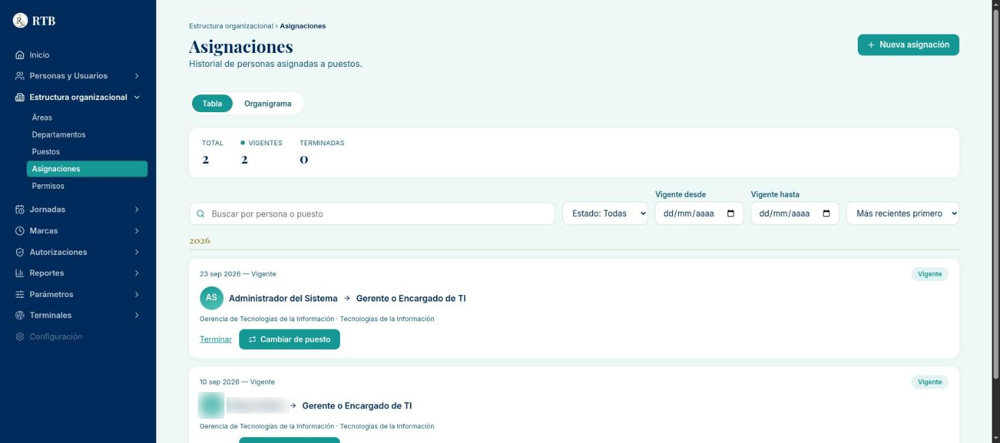
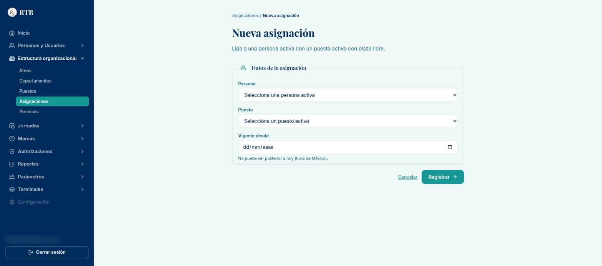
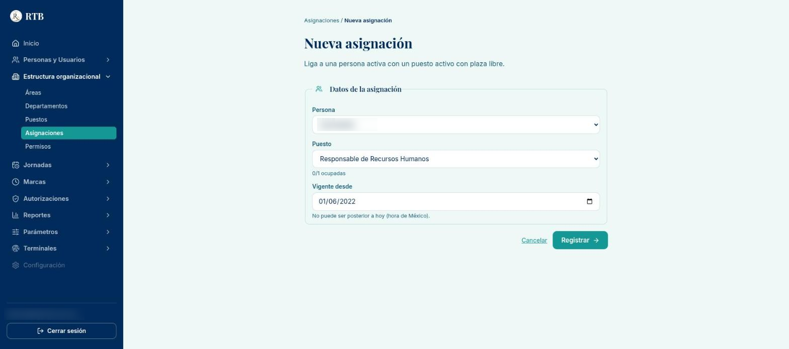
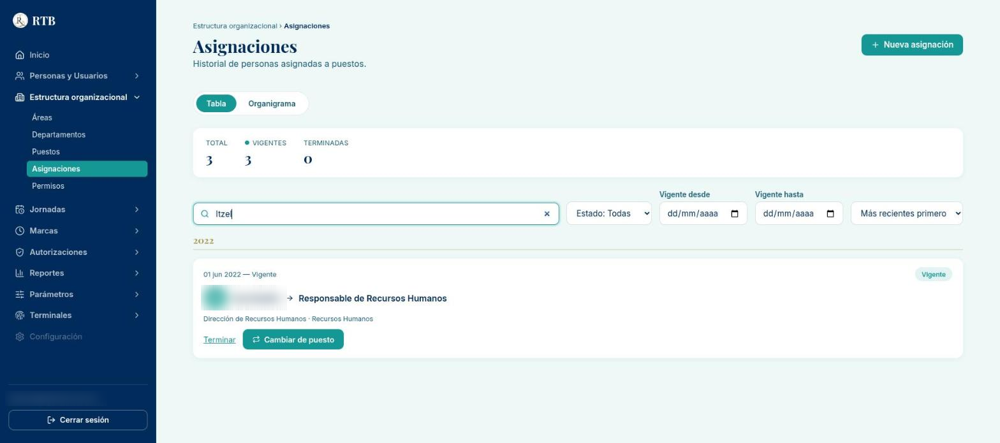
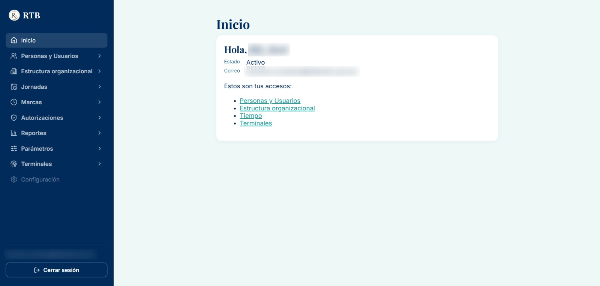
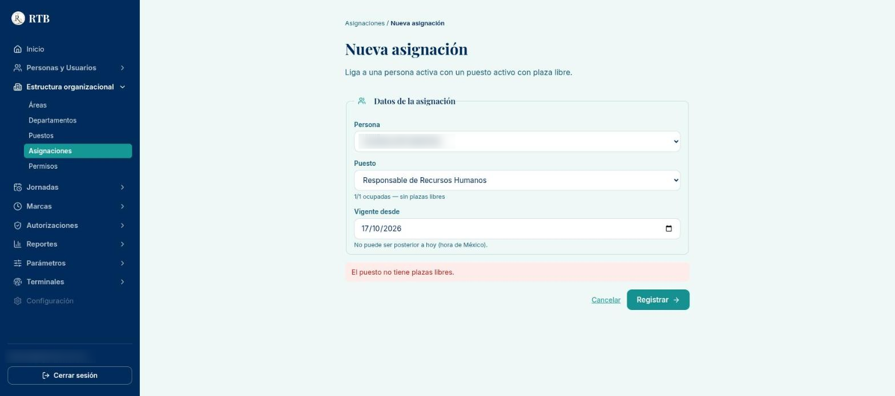
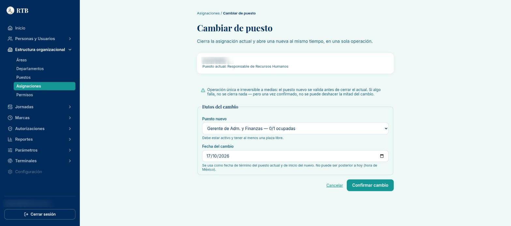
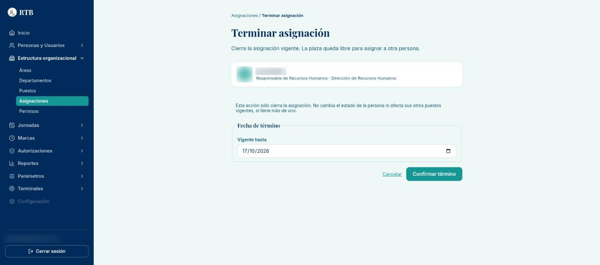

# Guía: asignar, cambiar y terminar el puesto de una persona

**Para:** Recursos Humanos. **Sistema:** RTB Sistema de Administración Central. **Estado:** BORRADOR v0.1 (16 de octubre de 2026),
recorrido en la app de pruebas el 17 de octubre de 2026 (primera asignación real: Responsable de Recursos Humanos).

El **puesto** decide qué ve y qué puede hacer cada persona en el sistema: los permisos se le dan al puesto, no a la persona. Sin un
puesto vigente, la persona entra pero solo ve **Inicio** con el aviso «Tu acceso está en configuración». Esta guía cubre tres acciones
desde **Estructura organizacional → Asignaciones**: (1) asignar un puesto, (2) cambiar de puesto y (3) terminar una asignación.

Va después de la guía de alta (`GUIA_ALTA_PERSONA_Y_USUARIO.md`): la persona ya debe estar registrada y **activa**.

## Antes de empezar

- Necesitas el permiso de **edición de asignaciones**. Hoy lo tienen «Responsable de Recursos Humanos» y «Gerente General». Si no lo
  tienes, el menú «Estructura organizacional» no aparece o el sistema rechaza la acción.
- **Nadie puede asignarse a sí mismo**, ni cambiarse de puesto, ni reabrir su propia asignación. Si RH necesita un puesto, lo asigna
  otra persona con el permiso.
- **La fecha de inicio no puede ser futura** (se cuenta en hora de México). Si la persona entra el lunes, la asignación se registra
  el lunes, no antes.
- **Cada puesto tiene un número de plazas.** Si todas están ocupadas, no se puede asignar a nadie más hasta terminar una asignación
  o ampliar las plazas del puesto (Estructura organizacional → Puestos).
- Lo registrado **no se borra**: queda en el historial. Revisa persona, puesto y fecha antes de confirmar.

## 1. Asignar un puesto

1. En el menú lateral entra a **Estructura organizacional → Asignaciones** y pulsa **«+ Nueva asignación»** (arriba a la derecha).

   

2. Se abre **«Nueva asignación»**. Llena los tres campos:

   | Campo | Nota |
   |---|---|
   | Persona | Solo aparecen personas **activas** |
   | Puesto | Solo aparecen puestos **activos**. Al elegirlo, debajo se ve cuántas plazas están ocupadas (por ejemplo «1/2 ocupadas»); si dice «sin plazas libres», ese puesto no admite a nadie más |
   | Vigente desde | El día en que la persona empieza en el puesto. Hoy o una fecha pasada, nunca futura |

   

   Así se ve ya lleno. Fíjate en el texto debajo del puesto: «0/1 ocupadas» quiere decir que tiene una plaza y está libre.

   

3. Pulsa **«Registrar»** **una sola vez** y espera. Si todo sale bien, vuelves al listado y la asignación aparece con la etiqueta
   **«Vigente»**. Volver al listado es la confirmación. Para encontrarla rápido, escribe el nombre en «Buscar por persona o puesto».

   

4. La persona verá los módulos de su puesto **la próxima vez que cargue el sistema** (que recargue la página o vuelva a entrar). En
   **Inicio** ya no aparece «Tu acceso está en configuración», sino **«Estos son tus accesos:»** con los módulos que le da su
   puesto, y el menú lateral los muestra habilitados:

   

> **Si algo no cuadra**, el sistema lo dice en rojo debajo del formulario y no registra nada:
> - «El puesto no tiene plazas libres.» → termina otra asignación de ese puesto o pide que amplíen sus plazas.
> - «Esta persona ya tiene una asignación vigente a ese puesto.» → ya estaba asignada; búscala en el listado.
> - «No puedes asignarte, cambiarte ni reabrirte una asignación a ti mismo; lo hace otra persona con permiso.»
> - «La fecha de inicio no puede ser futura.» → usa hoy o una fecha pasada.
> - «La persona no existe o no está activa.» / «El puesto no existe o está inactivo.» → revisa el estado de la persona o del puesto.

Ejemplo de puesto lleno: debajo del puesto ya se avisa «1/1 ocupadas — sin plazas libres» antes de enviar, y si se pulsa
«Registrar» aparece el mensaje en rojo (no se registró nada):

## 2. Cambiar de puesto

Se usa cuando la persona **deja un puesto y pasa a otro** (por ejemplo, un ascenso). Es una sola operación: cierra el puesto actual y
abre el nuevo con la misma fecha. Si algo falla, no se cierra nada.

1. En **Asignaciones**, busca la asignación **vigente** de la persona y pulsa **«Cambiar de puesto»**.
2. En **«Cambiar de puesto»** elige el **Puesto nuevo** (la lista muestra las plazas ocupadas de cada uno) y la **Fecha del cambio**:
   es el último día del puesto actual y el primero del nuevo. No puede ser futura.

   

3. Pulsa **«Confirmar cambio»** **una sola vez**. Una vez confirmado, **no se puede deshacer a medias**: si fue un error, se corrige
   con otro cambio de puesto.

> **Si falla:** los mismos mensajes del paso 1 (sin plazas libres, a ti mismo, fecha futura). En ese caso la asignación original
> **sigue vigente**, sin cambios.

## 3. Terminar una asignación

Se usa cuando la persona **deja el puesto sin pasar a otro** (baja, fin de proyecto, se quita una función). Terminar la asignación
**no da de baja a la persona** ni toca sus otros puestos vigentes, si tiene más de uno. La plaza queda libre.

1. En **Asignaciones**, en la asignación **vigente**, pulsa **«Terminar»**.
2. Escribe la fecha en **Vigente hasta** (no puede ser anterior al inicio de la asignación) y pulsa **«Confirmar término»**.

   

3. La asignación queda con la etiqueta **«Terminada»**.

> **Si la persona se va de la empresa**, además de terminar su asignación hay que registrar su **baja** en Personas y Usuarios
> (movimiento de estado). Son dos pasos distintos.

> «La fecha de término no puede ser anterior al inicio de la asignación.» → corrige la fecha.
> «No se puede hacer esto: dejaría al puesto administrador sin acceso.» → el puesto administrador del sistema siempre debe tener a
> alguien. Avisa a Sistemas.

## Revisar el historial

- La pestaña de **tabla** de Asignaciones muestra todas, con filtros por estado (Vigentes / Terminadas), fechas y búsqueda por persona
  o puesto. La pestaña de **organigrama** muestra los puestos por jerarquía.
- Cada persona tiene su propia **bitácora de asignaciones** con todos sus puestos, pasados y vigentes.

## Preguntas frecuentes

- **Asigné el puesto y la persona sigue viendo «Tu acceso está en configuración».** Que recargue la página o cierre y vuelva a entrar.
  Si sigue igual, revisa que el puesto tenga permisos (Estructura organizacional → Permisos) y avisa a Sistemas.
- **Me equivoqué de puesto.** Usa «Cambiar de puesto» con la fecha correcta. No se borra la asignación equivocada: queda en el historial.
- **Necesito registrar a alguien que empieza la próxima semana.** Espera a ese día; el sistema no acepta fechas futuras.
- **El puesto dice más plazas ocupadas que totales** (por ejemplo «2/1»). Pasa hoy con el puesto administrador, por la cuenta técnica
  de arranque del sistema. No es un error; Sistemas lo regulariza ampliando las plazas.

## Qué NO hacer

- No pulses «Registrar», «Confirmar cambio» ni «Confirmar término» varias veces seguidas.
- No termines y vuelvas a crear una asignación para «corregir» un puesto: usa «Cambiar de puesto».
- No asignes un puesto «de prueba» a una persona real: queda en su historial.

---
*Pendiente de completar en esta guía:* revisar los textos con RH tras su primer uso real.
