# Guía: enrolar la huella de una persona en la terminal

**Para:** Recursos Humanos y Sistemas (TI). **Sistema:** RTB Sistema de Administración Central. **Estado:** BORRADOR v0.1 (19 de
octubre de 2026), armado con el primer enrolamiento real en la app de pruebas (17 de octubre de 2026). Fotos del aparato agregadas el 20 y 21 de
octubre de 2026; faltan dos capturas del sistema (marcadas como *pendiente*).

**Enrolar** es dejar a una persona lista para marcar su entrada y salida con la huella en la terminal Hikvision. Tiene tres partes:
**(A)** en el sistema se asigna a la persona a la terminal, **(B)** en el propio aparato se registra su huella, y **(C)** en el
sistema se confirma que la huella quedó. **La huella nunca sale del aparato:** el sistema solo guarda que la persona está dada de
alta y quién lo confirmó.

Va después de las guías de alta, de asignar puesto y de asignar jornada: la persona ya debe estar registrada y **activa**.

## Antes de empezar

- **Consentimiento firmado.** La persona debe haber recibido el aviso de privacidad y firmado su consentimiento **en papel** para
  el uso de su huella. Ese documento se guarda en su expediente. **Sin consentimiento firmado no se enrola.**
- **Permiso.** Asignar y confirmar exige el permiso de **edición de usuarios de la terminal**. Hoy lo tienen «Responsable de
  Recursos Humanos», «Gerente General» y «Gerente o Encargado de TI».
- **Quiénes deben estar.** La huella se registra en el menú del aparato, que solo abre **TI** con su contraseña de administrador.
  **RH está presente** como testigo, y la persona está frente a la terminal.
- **Nadie se enrola a sí mismo.** El sistema no te deja asignarte ni confirmar tu propia huella: tu nombre no aparece en la lista.
  Otra persona con el permiso lo hace por ti. La única excepción técnica es el puesto administrador («Gerente o Encargado de TI»),
  pero **también a esa persona la asigna y la confirma alguien más**, para que siempre haya un testigo.
- **Hazlo de corrido.** Si la huella no se registra dentro de **24 horas** desde que el aparato creó al usuario, el sistema da de
  baja esa alta sola y hay que volver a asignar.

## A. Asignar a la persona en el sistema

1. En el menú lateral entra a **Terminales → Terminales**. Revisa que la terminal diga **«En línea»**. Pulsa **«Usuarios →»**.

   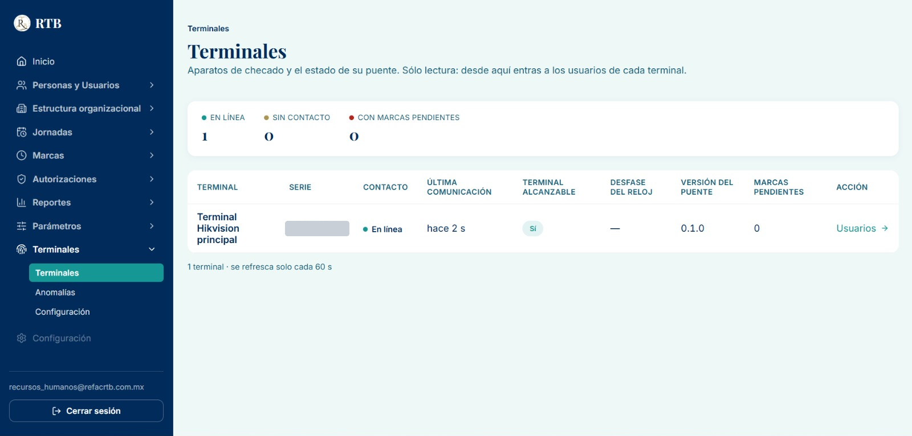

2. En **Usuarios de la terminal** pulsa **«Asignar persona»** (arriba a la derecha). Se abre la ventana **Asignar persona a la
   terminal**:

   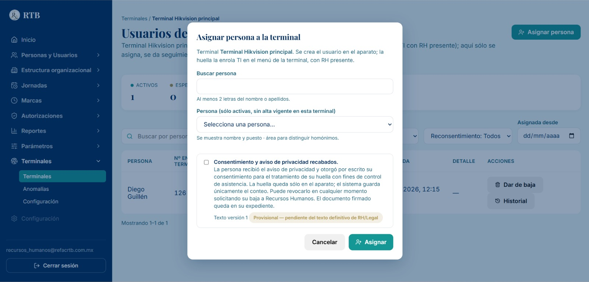

3. Escribe al menos 2 letras del nombre en **Buscar persona** y elige a la persona en la lista. Junto al nombre ves su puesto y área,
   para distinguir a quienes se llamen igual. La lista solo muestra personas **activas** que **no** tienen ya un alta en esta
   terminal, y nunca te muestra a ti.

4. Lee el texto del consentimiento y marca **«Consentimiento y aviso de privacidad recabados»** solo si ya tienes el documento
   firmado. Pulsa **«Asignar»** **una sola vez**.

   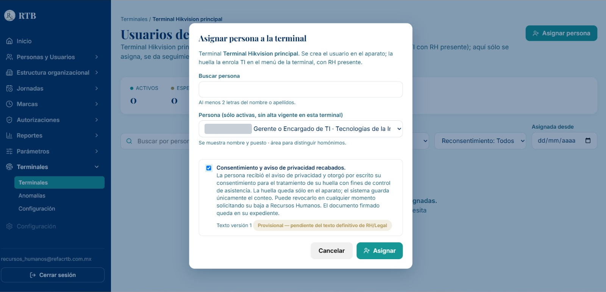

5. La persona aparece en la tabla como **«Pendiente de alta»**. Al poco tiempo el sistema crea a la persona en el aparato y la
   fila pasa a **«Esperando huella»**. Anota el **Nº en la terminal**: es el número con el que TI la buscará en el aparato.

   *Pendiente: captura de la fila en «Esperando huella».*

## B. Registrar la huella en el aparato (TI con RH presente)

6. En la pantalla de inicio (la del reloj), TI pulsa **OK**. Aparece **Iniciar sesión**: elige **«CTRSÑ DISP»** (contraseña del
   dispositivo) y escribe la contraseña de administrador. **No fotografíes ni dejes ver el teclado mientras se escribe.**

   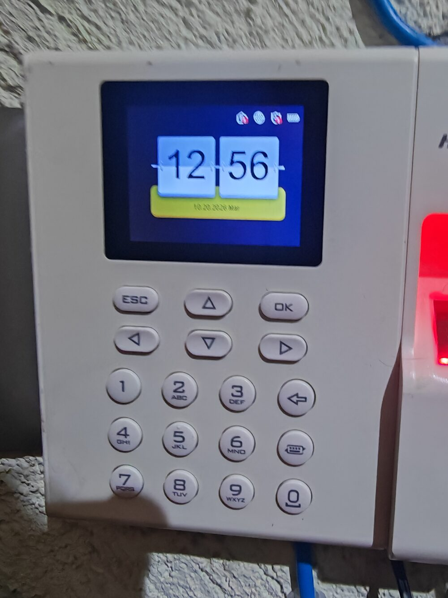

   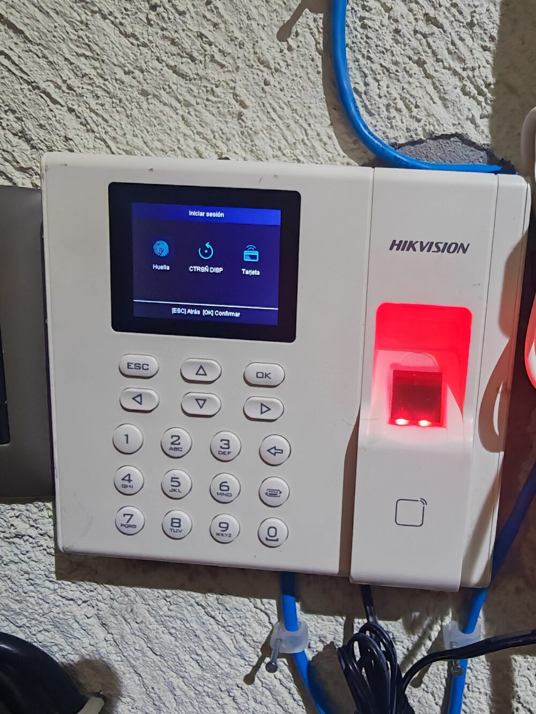

7. En el menú principal entra a **Usuario**.

   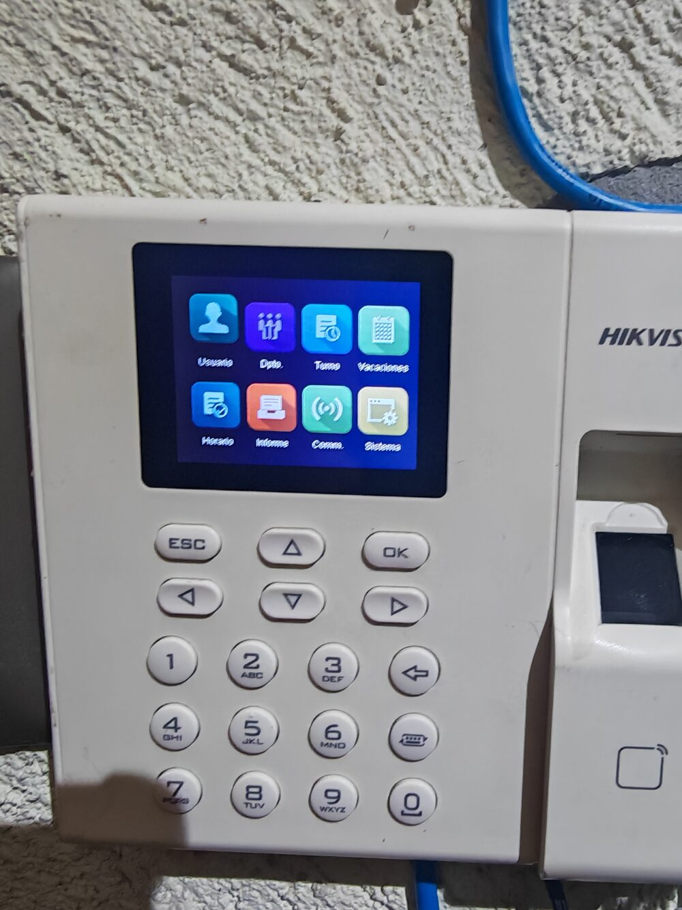

8. En la pestaña **Usuario** escribe el **Nº en la terminal** que anotaste en el paso 5 y elige su fila con **OK**. En el aparato
   la persona **no aparece con su nombre real**: el sistema la crea con el nombre **«U» seguido de su número** (por ejemplo, el Nº
   126 aparece como «U126»). Revisa que el ID y el nombre coincidan con el Nº anotado. La columna **HD** dice cuántas huellas tiene
   registradas; una persona recién asignada tiene **0**.

   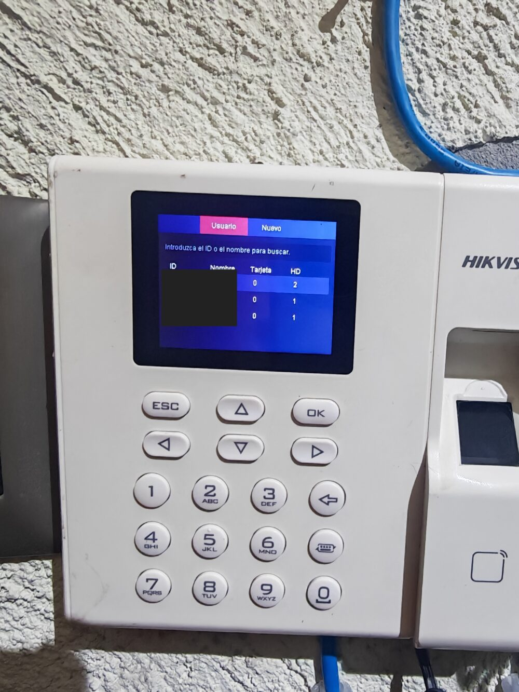

9. Se abre **Editar usuario**. Baja a **Huella** y pulsa **Editar**.

   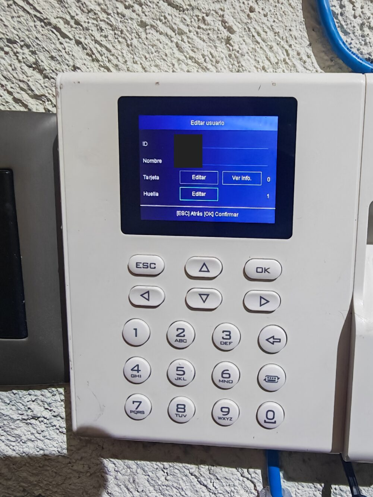

10. Aparece la lista de dedos. Elige el dedo que se va a registrar (de preferencia el **índice**) y pulsa **OK**. En **Grabar
    huella** deja el tipo en **«Huella dactilar normal»** y pulsa **OK**.

    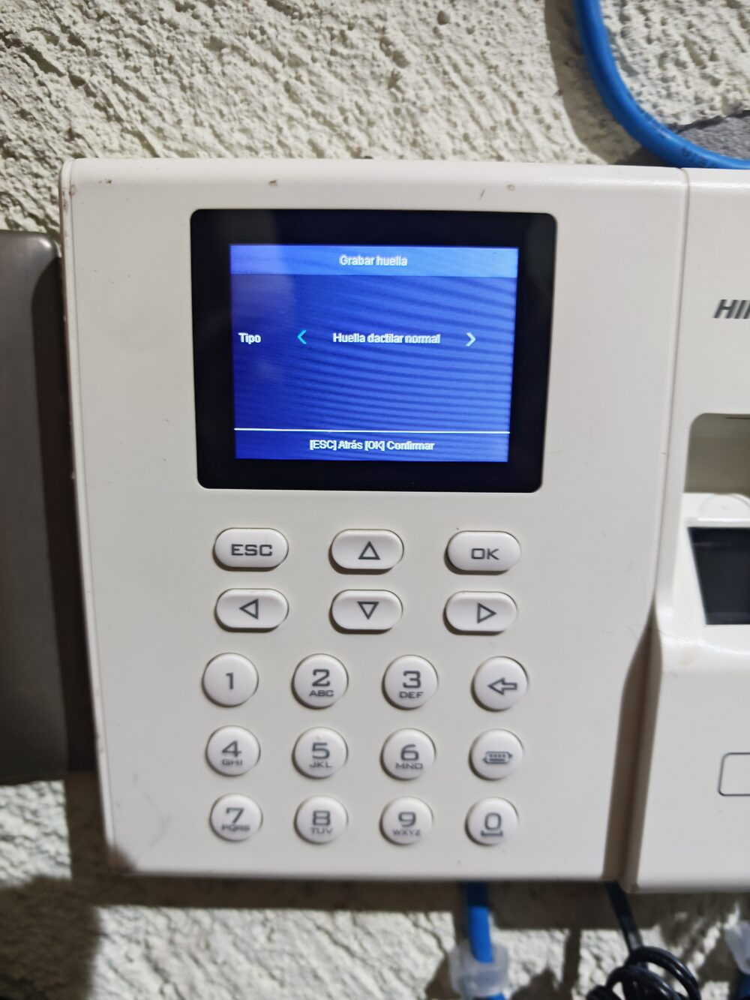

    La pantalla dice **«Pulse con el dedo.»** Pide a la persona que apoye ese mismo dedo en el lector, plano y centrado, las veces
    que el aparato lo pida. Al terminar regresa a la lista de dedos y ese dedo pasa de «No añadido» a **«Añadido»**.

    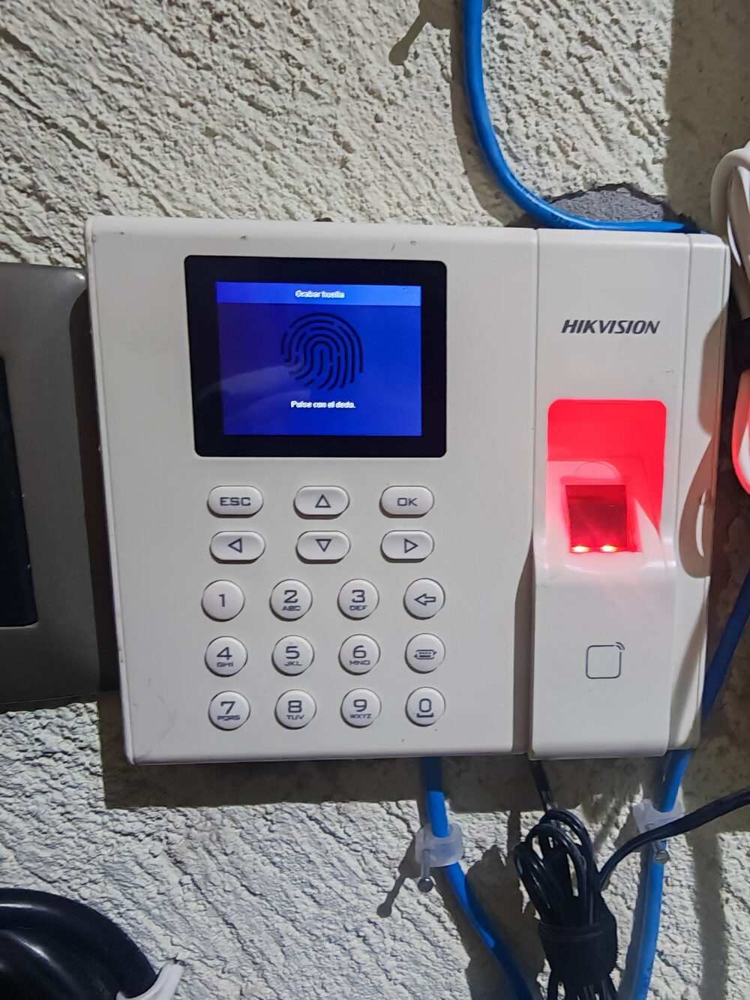

    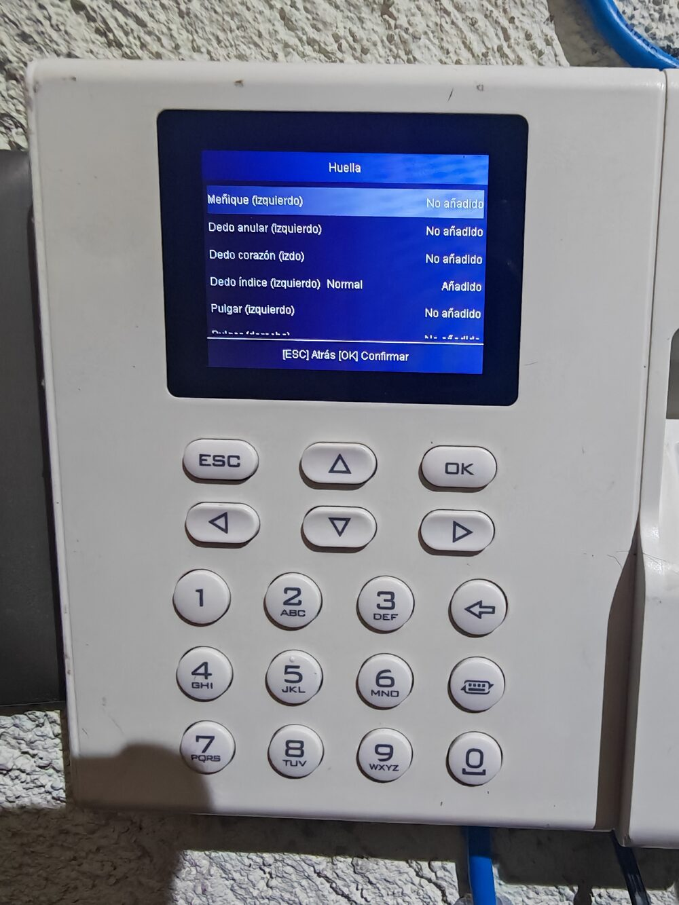

11. Pulsa **ESC** una vez: de regreso en **Editar usuario**, el número junto a **Huella** ya debe ser **1** o más. Después pulsa
    **ESC** las veces necesarias hasta volver a la pantalla del reloj.
12. **Prueba de marca.** La persona pone su dedo. La pantalla debe mostrar la **palomita con «Autenticado.»** y, a la
    izquierda, su ID y nombre («U» más su número; el aparato oculta los primeros dígitos con asteriscos, así que revisa los últimos).
    Si no sale «Autenticado», o los últimos dígitos no coinciden, **no sigas a la parte C**: avisa a Sistemas.

    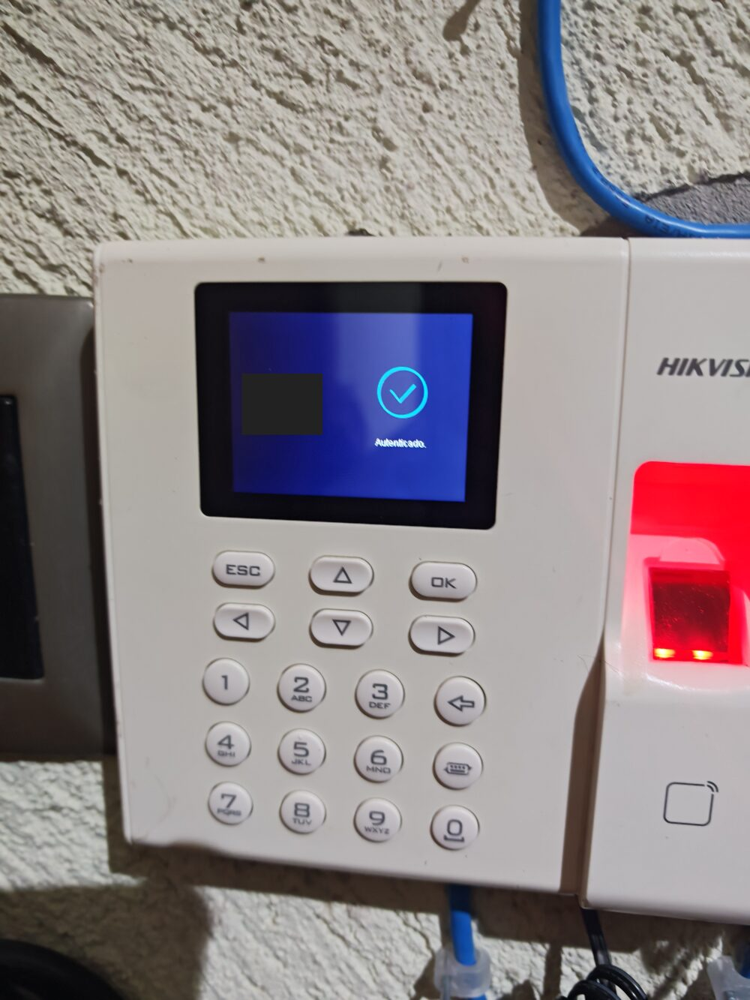

## C. Confirmar la huella en el sistema

13. Vuelve a **Usuarios de la terminal**. En la fila de la persona (estado «Esperando huella») pulsa **«Confirmar huella»**.
14. Escribe una **nota** de al menos 10 caracteres sobre lo que viste. Por ejemplo: «Vi la huella registrada en el menú del
    aparato». Pulsa **«Confirmar que vi la huella»**. **Esto no se puede deshacer:** estás atestiguando que viste la huella en el
    aparato, y queda en una bitácora que nadie puede editar.

    *Pendiente: captura de la ventana «Confirmar huella».*

15. La fila pasa a **«Activo»**, con la etiqueta **«Huella confirmada por una persona (sin conteo)»**. La persona ya puede marcar.

    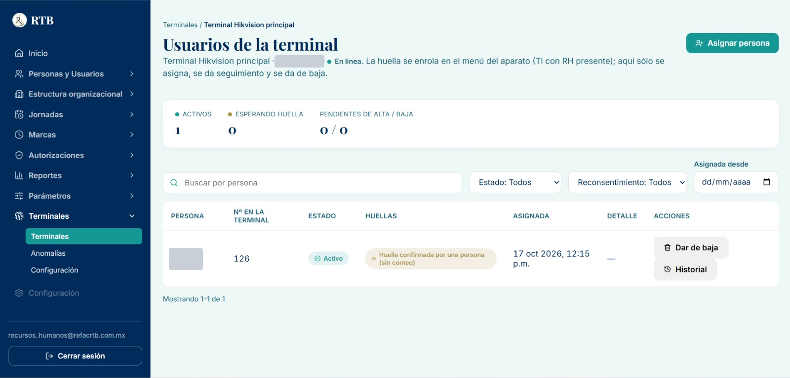

16. Para comprobarlo, entra a **Marcas → Registro de marcas**: la marca de prueba del paso 12 aparece en menos de un minuto.

## Preguntas frecuentes

- **¿Por qué dice «sin conteo»?** El aparato muestra en su propio menú cuántas huellas tiene cada persona (columna HD), pero no se
  lo informa al sistema. Por eso el sistema guarda que **una persona lo confirmó**, no un número. Es el estado normal y definitivo; no es un pendiente.
- **No encuentro a la persona en «Asignar persona».** Revisa que esté activa, que no tenga ya un alta en esta terminal y que no sea
  tu propio nombre.
- **La fila se quedó en «Pendiente de alta».** Revisa en **Terminales** que la terminal diga «En línea». Si sigue igual después de
  unos minutos, avisa a Sistemas.
- **Algunas marcas dicen «Sin sincronizar».** Pasa con marcas que llegaron tarde al sistema (por ejemplo, recuperadas después de un
  corte del puente). Las marcas nuevas llegan como «Sincronizado».
- **Me equivoqué de persona.** Usa **«Dar de baja»** en su fila y vuelve a asignar a la persona correcta. Nunca confirmes una huella
  que no viste.

## Qué NO hacer

- No marques la casilla de consentimiento sin el documento firmado en la mano.
- No confirmes la huella si la prueba de marca no mostró «Autenticado.» con el número correcto.
- No fotografíes la contraseña del aparato, la etiqueta con su número de serie ni la cara de la persona.
- No te asignes ni confirmes tu propia huella, aunque tu puesto lo permita.
- No pulses «Asignar» ni «Confirmar que vi la huella» dos veces.
