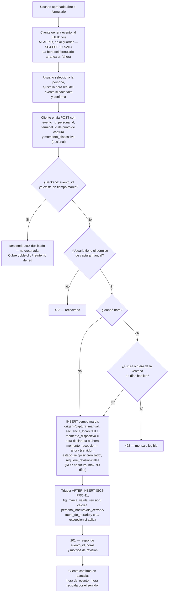

# Proceso — Captura manual de marca

**Sistema de Control de Jornada**
Folio SCJ-PRO-07 · Versión 1.2 · 23 de octubre de 2026

> **Cambio de versión (V1.1 → V1.2, menor, 23-oct-2026):** el documento se pone al día con lo que
> ya está construido. No cambia ninguna regla del código; corrige lo que el texto decía mal.
> (1) **§VI «Estado actual» ya no dice «nada construido»:** backend, RLS y frontend existen desde
> el 7 de septiembre (ver §VI). (2) **La hora ya no es siempre la del servidor.** Desde `61_*.sql`
> (7-sep), quien captura puede declarar el momento real del evento (`momento_dispositivo`). Esa
> hora no puede ser futura y no puede quedar fuera de la ventana de días hábiles
> (`dias_habiles_correccion_marca`). La RLS pone además un techo duro de 90 días. Si no se manda
> hora, se usa la del servidor (comportamiento de la V1.1). Se corrigen el diagrama, el paso D1 y
> las reglas de §V. (3) **La captura manual es también la contingencia** cuando falla la terminal:
> decisión del 23-oct-2026 que cierra la tarea V3.8 del plan («checador de contingencia por
> navegador»). No hay un modo contingencia aparte ni un tercer valor de `origen` (§V, §VI.2).

> **Cambio de versión (V1.0 → V1.1, menor):** el chequeo de `persona_inactiva` que hacía el
> backend antes de insertar (con `requiere_revision` fijado a mano según el resultado) se
> reemplaza por `trg_marca_valida_revision` (`SCJ-PRO-11`) — un disparador centralizado que corre
> sobre cualquier `tiempo.marca`, sin importar el origen. El resultado observable no cambia; sólo
> se dejó de duplicar la misma regla en dos lugares.

Primer documento `SCJ-PRO` del subsistema de **Tiempo** — grupo `Registro-marcas-jornadas-
ausencias-asistencias` del diagrama Lucid. Cubre `origen = captura_manual`
(`SCJ-ESP-01 §IV.2`, `SCJ-CDT-01 §XIII`): la vía por la que marca quien no otorgó consentimiento
biométrico o no logra enrolar por desgaste del dedo, y la vía de contingencia cuando la terminal no
está disponible. **No es una excepción rara: es una fuente ordinaria del sistema**, y así se diseña
este proceso.

---

## I. Alcance

**Cubre:** desde que un usuario aprobado abre el formulario de captura manual, hasta que la marca
queda en `tiempo.marca` con `origen = 'captura_manual'`, idempotente frente a reintentos.

**No cubre — son procesos o piezas resueltas en otro lugar:**

- Registro por terminal (`origen = 'terminal'`) — `SCJ-PRO-11`.
- Corrección de una marca ya registrada (`tiempo.correccion`) — un ajuste **posterior**, distinto
  de la captura manual, que registra un evento que no quedó registrado. Ver `SCJ-PRO-10` y
  `SCJ-DEC-03`.
- Cierre del día, armado de `tramo` y generación de `excepcion` por paridad — `SCJ-PRO-12`.

---

## II. Precondiciones

1. La persona a marcar ya existe en `tiempo.persona` (sincronizada desde `personas.persona`). Si
   está inactiva, la marca se guarda igual y queda señalada (§V).
2. Quien captura tiene una sesión válida y el permiso `captura_manual_edicion` — confirmado con el
   usuario 2026-09-05, **NO heredable** (a diferencia de `alta_personas_usuarios`). Lo tienen hoy
   `Gerente General`, `Responsable de Recursos Humanos` y `Gerente o Encargado de TI`
   (`db/ddl/33_permiso_tiempo_migracion_inicial.sql`, `34_puesto_permiso_tiempo_mapeo_inicial.sql`
   — ver `SCJ-PRA-01 #04`, resuelta).
3. Existe un `terminal_id` de punto de captura para identificar de dónde salió la marca (no es un
   aparato físico — `SCJ-ESP-01 §VII.1` permite que `terminal_id` identifique "el aparato o el
   punto de captura"). El frontend usa el valor fijo `rh-captura-01`
   (`CapturaManualMarcaPage.tsx`).

---

## III. Diagrama de flujo — estado actual

---

## IV. Descripción paso a paso

| Paso | Actor | Acción | Toca |
|---|---|---|---|
| A1 | Usuario aprobado | Abre «Captura manual de marca» (`/tiempo/captura-manual`) | — |
| A2 | Cliente (frontend) | Genera `evento_id` **al abrir el formulario**, no al dar guardar — es la llave de idempotencia; si RH reintenta tras no ver respuesta, reenvía el mismo `evento_id` en vez de generar uno nuevo. El campo de hora arranca en la hora actual | — |
| A3 | Usuario | Selecciona la persona a marcar y, si el evento ocurrió antes (por ejemplo, la terminal estaba caída), escribe la hora real en que ocurrió | `personas.persona` (sólo lectura, vía `persona_id`) |
| A4 | Cliente | Envía `evento_id`, `persona_id`, `terminal_id` y `momento_dispositivo` | — |
| B1 | Backend | Busca `evento_id` en `tiempo.marca` (`uq_marca_evento_id`) | `tiempo.marca` |
| B2 | Backend | Si ya existe, responde `200` con `duplicado = true`, sin insertar — reintento seguro. También si dos envíos chocan en el `INSERT` (violación de unicidad) | — |
| B3 | Backend | Valida el permiso con `requiere_permiso("captura_manual_edicion")` (`backend/app/permisos.py`) | `personas.puesto_permiso`, `.asignacion` |
| B4 | Backend | Sin permiso, `403` | — |
| C1–C3 | Backend | Si llegó `momento_dispositivo`: rechaza con `422` una hora futura o una que pase del límite de días hábiles (`dias_habiles_correccion_marca` y `tiempo.dia_festivo`, en `app/dias_habiles.py`) | `tiempo.parametro`, `tiempo.dia_festivo` (lectura) |
| D1 | Backend | `INSERT` con `origen='captura_manual'`, `secuencia_local=NULL` (ese contador es del terminal), `momento_dispositivo` = hora declarada o la del servidor si no se mandó, `momento_recepcion` = hora del servidor, `desfase_local` = desfase de México en ese momento, `estado_reloj='sincronizado'`, `version_software` = versión de la app web, `requiere_revision=false` — el trigger decide si cambia. La RLS (`61_*.sql`) vuelve a exigir: permiso, persona que captura activa, hora no futura, máximo 90 días atrás y `estado_reloj='sincronizado'` | `tiempo.marca` |
| E1 | Sistema (trigger `trg_marca_valida_revision`, `SCJ-PRO-11`) | Calcula `persona_inactiva`/`dia_cerrado`/`fuera_de_horario` (el mismo cálculo centralizado que usa el flujo de terminal) y crea `tiempo.excepcion` si aplica — la evidencia de que alguien marcó nunca se descarta, sólo se señala | `tiempo.excepcion` |
| F1 | Backend | Responde `201` con `evento_id`, `momento_dispositivo`, `momento_recepcion`, `requiere_revision` y `motivos_revision`, releídos después del trigger | — |
| G1 | Cliente | Muestra la hora del evento y la hora en que la recibió el servidor. Al capturar otra, genera un `evento_id` nuevo | — |

---

## V. Reglas de negocio confirmadas

- **`evento_id` nace al abrir el formulario, no al guardar** (`SCJ-ESP-01 §VII.4`). Es lo que
  vuelve segura la práctica real: RH llena el formulario, da guardar, no ve respuesta, vuelve a dar
  guardar — sin este orden esa persona termina con dos marcas a la misma hora, y como las marcas se
  emparejan por paridad, eso corre el día entero.
- **La hora del evento se puede declarar, dentro de límites** (cambio de la V1.2; en la V1.1 la
  tomaba siempre el servidor). Sirve para registrar la hora real cuando la persona no pudo marcar en
  la terminal. Límites: nunca futura; dentro de la ventana de días hábiles del parámetro
  `dias_habiles_correccion_marca` (backend, mensaje legible); y, como respaldo ante quien llame a la
  base sin pasar por el backend, máximo 90 días naturales (RLS `61_*.sql`). `momento_recepcion`
  siempre es la hora del servidor: las dos horas quedan guardadas y se ve la diferencia.
- **Captura manual no es corrección.** La captura registra un evento que no quedó registrado; la
  corrección (`SCJ-PRO-10`) cambia el valor de una marca que ya existe, sin modificarla.
- **No es una excepción rara, es una vía ordinaria y permanente**, sin consecuencia alguna para
  quien la use — no hay penalización ni marca especial visible a la persona por usarla.
- **Es también la contingencia cuando falla la terminal** (decisión del 23-oct-2026). No existe un
  «modo contingencia» que RH active y que caduque: el permiso `captura_manual_edicion` ya limita
  quién puede capturar.
- **`secuencia_local` siempre `NULL`** en captura manual — ese contador pertenece al terminal físico
  (`ck_marca_secuencia_solo_terminal`).
- **`estado_reloj` siempre `'sincronizado'`** — no hay reloj de aparato remoto que pueda derivar.
  El backend lo fija y la RLS lo exige. Consecuencia: `requiere_revision` por captura manual nunca
  se dispara por reloj — sólo por `persona_inactiva`, `dia_cerrado` o `fuera_de_horario`, los tres
  calculados por `trg_marca_valida_revision` (`SCJ-PRO-11`).
- **`origen` es exactamente 2 valores** (`terminal` / `captura_manual`) — no existe un tercero.
  `SCJ-CDT-01 V2.0`/`SCJ-ESP-01 V2.0` corrigieron una divergencia del modelo lógico que había
  introducido `contingencia` sin respaldo (ver bitácora 2026-09-05). Las marcas capturadas durante
  una falla de la terminal se distinguen por `origen = 'captura_manual'`.
- **`capturista_id` no vive en Tiempo.** Quién de RH ejecutó la captura se registra en la bitácora
  del esquema Operación, ligado por `evento_id` — fuera del alcance de este repositorio
  (`SCJ-ESP-01 §I.4` regla 4). El backend puede loguearlo donde corresponda, pero no en
  `tiempo.marca` ni en ninguna tabla de Tiempo.
- **La evidencia nunca se pierde por un error del sistema** — si la persona resulta inactiva, la
  marca se inserta igual y se señala, no se rechaza (`SCJ-CDT-01 §II.5`).

---

## VI. Estado actual — construido

### VI.1 Piezas

| Pieza | Dónde | Desde |
|---|---|---|
| Permiso `captura_manual_edicion` (no heredable) | `db/ddl/33_*.sql`, `34_*.sql` | 5-sep |
| RLS de inserción y lectura de `tiempo.marca` | `db/ddl/46_tiempo_rls_marca_excepcion_humano.sql` | 6-sep |
| Techo de hora en la RLS (no futuro, 90 días, `estado_reloj`) | `db/ddl/61_tiempo_marca_ventana_captura_manual.sql` | 7-sep |
| Endpoint `POST /api/marcas/captura-manual` | `backend/app/routers/marcas.py`, esquemas en `backend/app/schemas/marcas.py` | 6–7-sep |
| Ventana de días hábiles | `backend/app/dias_habiles.py` (compartida con `SCJ-PRO-10`) | 7-sep |
| Pantalla «Captura manual de marca» | `frontend/src/pages/CapturaManualMarcaPage.tsx`, ruta `/tiempo/captura-manual`, con pruebas | 6–7-sep |
| Desfase en hora de México (no la del contenedor ni la del navegador) | `16bac6e`, `6787146` | 11-sep |

Fechas según las bitácoras del repo (`bitacora/2026-09-06_implementacion_subsistema_tiempo.md`,
`bitacora/2026-09-07_registro_marcas_hora_dispositivo.md`); en el historial de git todo aparece
desde el 10-sep, con la base heredada (`d7a1418`).

Las marcas capturadas se consultan en «Registro de marcas» (`GET /api/marcas`, permiso
`marca_lectura` o `captura_manual_edicion`), con sus motivos de revisión.

### VI.2 Uso como contingencia de la terminal

Cuando la terminal Hikvision o el puente del Pi no están disponibles, RH registra las entradas y
salidas desde «Captura manual de marca», con la hora real de cada evento. No hace falta activar
nada. La terminal guarda sus propias marcas mientras tiene batería y el puente las sincroniza al
volver. **Cuidado:** si una persona alcanzó a marcar en la terminal y además se le captura a mano el
mismo evento, quedan dos marcas del mismo momento. Antes de capturar, RH revisa en «Registro de
marcas» si la marca de la terminal ya llegó; si se duplicó, se resuelve en la revisión del día.

---

## VII. Siguiente paso

Ninguno pendiente de construcción en este proceso. Si se quiere saber quién capturó cada marca,
eso depende del esquema Operación (fuera de este repositorio, §V).

---

*Proceso · Folio SCJ-PRO-07 · V1.2*
