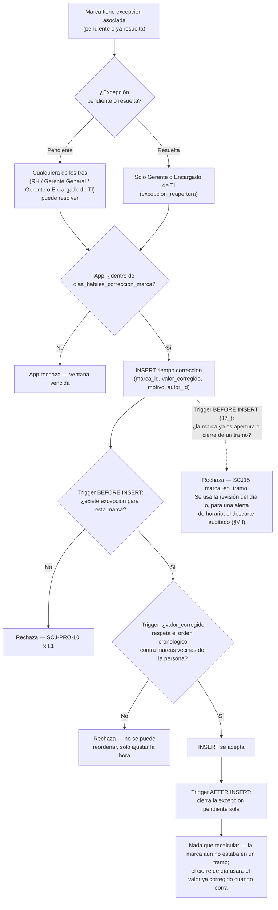

# Proceso — Corrección de marca

**Sistema de Control de Jornada**
Folio SCJ-PRO-10 · Versión 2.0 · 21 de octubre de 2026

Cuarto `SCJ-PRO` del subsistema de **Tiempo**. Cubre cómo se corrige el valor de una marca
(`tiempo.correccion`) sin modificarla nunca — `SCJ-DEC-03`.

> **Cambio de versión (V1.0 → V2.0, mayor, 21-oct-2026):** este proceso se contradice en tres puntos y por eso sube de versión mayor. (1) **Una marca que ya forma parte de un tramo ya no se corrige:** `87_` bloquea la corrección (`SCJ15` / `marca_en_tramo`) porque, cerrado el día, recalcular el tramo afectaba 0 filas por RLS y dejaba la hora vieja en el tramo, las horas y el corte; el recálculo tras corregir (V1.0, §V y paso J1-K2) ya no ocurre por esta vía. (2) **La corrección solo existe mientras la marca aún no está en un tramo**, es decir, con el día abierto; para un día ya cerrado o revisado se usa la revisión del día o, para una alerta de horario, el descarte auditado de `125_` (§VII). (3) **Cierra el «Estado actual»:** la RLS, el backend y el frontend de la corrección ya existen. Además: la policy de INSERT de `tiempo.correccion` tenía un defecto (`117_`) que exigía `excepcion_reapertura` a todos; hoy `correccion_edicion` basta para una excepción pendiente, y `excepcion_reapertura` (solo TI) se exige además cuando la excepción ya estaba resuelta. `123_` garantiza que dos correcciones de la misma marca nunca compartan `creado_en` y que el tramo cuadre con el momento efectivo de sus marcas.

---

## I. Alcance

**Cubre:** desde que una marca tiene una `excepcion` asociada, hasta que la corrección queda
registrada, la excepción pendiente se cierra sola, y el `tramo`/`dia` afectados quedan
recalculados.

**No cubre — son procesos o piezas pendientes en otro lugar:**

- Cómo llega la marca a tener una `excepcion` en primer lugar — eso lo decide el batch de cierre de
  día (pendiente de diseñar aparte) o el registro directo con `requiere_revision=true`.
- Recalcular `clasificacion_de_tiempo.tipo` tras una corrección — depende del disparador de
  clasificación, todavía sin programar.

---

## II. Precondiciones

1. **La marca ya tiene una `excepcion` asociada — sin excepción, no hay corrección posible.** Es la
   única señal que tiene el sistema de que esa marca necesita revisión; no existe corrección libre
   sobre cualquier marca.
2. Quien corrige tiene permiso `correccion_edicion` — hoy `Gerente General`, `Responsable de
   Recursos Humanos`, `Gerente o Encargado de TI` (`db/ddl/35_permiso_correccion_migracion_
   inicial.sql`, `36_puesto_permiso_correccion_mapeo_inicial.sql`), mismos tres del resto del
   módulo. Heredable, igual que `ausencia`/`excepcion`.
3. **Si la `excepcion` ya está `resuelto`** (se quiere editar/reabrir una que ya se cerró), hace
   falta además `excepcion_reapertura` — **no heredable, exclusivo de `Gerente o Encargado de
   TI`**. Ni RH ni Gerente General pueden hacerlo, aunque tengan `correccion_edicion`.
4. La marca a corregir sigue dentro de la ventana de `tiempo.parametro.dias_habiles_correccion_
   marca` (30 días hábiles de ejemplo) contados desde su `momento_dispositivo`.

---

## III. Diagrama de flujo — estado objetivo

---

## IV. Descripción paso a paso

| Paso | Actor | Acción | Toca |
|---|---|---|---|
| A1-B1 | — | La marca tiene una excepción; se revisa si ya estaba resuelta | `tiempo.excepcion` |
| C1/C2 | Usuario | Según el estado de la excepción, resuelve cualquiera de los tres o sólo TI | — |
| D1-D2 | App | Valida la ventana de 30 días hábiles antes de enviar (validación de UX, no de integridad) | `tiempo.parametro` |
| E1 | Usuario | Envía la corrección | `tiempo.correccion` |
| F1-F2 | Sistema (trigger `BEFORE INSERT`) | Exige que exista una excepción para esa marca | `tiempo.excepcion` |
| G1-G2 | Sistema (trigger) | Calcula el momento efectivo de la marca anterior y siguiente de la misma persona (última corrección si existe, si no el original) y bloquea si `valor_corregido` cruza cualquiera de las dos | `tiempo.marca`, `tiempo.correccion` |
| H1 | Sistema | Inserta la corrección | `tiempo.correccion` |
| I1 | Sistema (trigger `AFTER INSERT`) | Cierra sola la excepción si seguía `pendiente` | `tiempo.excepcion` |
| X1 | Sistema (trigger `BEFORE INSERT`, `87_`) | Si la marca ya es apertura o cierre de un `tramo` (cerrado o abierto), rechaza con `SCJ15` / `marca_en_tramo`; el backend lo corta antes con un 409. **Reemplaza al recálculo de V1.0** | `tiempo.tramo` |
| K2 | Sistema | Sin tramo, nada que recalcular: el cierre de día usa el valor corregido porque lee la cadena de correcciones | — |

---

## V. Reglas de negocio confirmadas

- **Sólo se corrige resolviendo una excepción — nunca libre.** Sin excepción asociada, el sistema
  no tiene forma de saber que esa marca necesitaba revisión (confirmado por el usuario).
- **Editar/reabrir una excepción ya resuelta es exclusivo de TI**, con un permiso propio
  (`excepcion_reapertura`) distinto del `excepcion_edicion` que ya tienen los tres — evita que la
  autorización dependa de comparar el nombre del puesto en el código; es un permiso atómico más,
  mismo patrón que el resto del proyecto.
- **La corrección ajusta la hora, nunca el orden.** Si el nuevo valor haría que esa marca deje de
  estar entre su vecina anterior y siguiente (cruzaría el orden cronológico de la persona), el
  sistema bloquea la corrección — se calcula contra el **momento efectivo** de las marcas vecinas
  (la corrección más reciente si ya tienen una, si no su valor original), no contra el valor
  original si ya fue corregido antes.
- **Esta regla vive en la base (`CONSTRAINT` no aplica, es `BEFORE INSERT` normal porque
  `correccion` se inserta fila por fila, no en lote como `patron_semanal`)** — es la misma
  integridad que sostiene el modelo de paridad/tramo completo, no una regla de negocio cualquiera.
- **La ventana de 30 días hábiles vive sólo en la aplicación**, a diferencia de lo anterior — es
  política de proceso, no una invariante estructural; el costo de que alguien la salte por
  PostgREST directo es bajo, y el valor real (30) es configurable en `tiempo.parametro` para poder
  cambiarlo sin tocar código.
- **Ya no hay recálculo tras corregir (V2.0).** Una marca solo se corrige antes de formar parte de un tramo, así que no hay tramo ni `horas_totales` que recalcular: el cierre de día lee `momento_dispositivo` desde la marca original más su cadena de correcciones (la corrección más reciente por `creado_en`; dos correcciones de la misma marca no pueden compartir `creado_en`, índice único de `123_`), no un valor cacheado. `fn_correccion_recalcula_tramo` sigue instalada pero ya no se alcanza por esta vía (`87_`).

---

## VI. Estado actual (V2.0): construido

Construido: los disparadores (`fn_correccion_valida` y `fn_correccion_bloquea_marca_en_tramo`, esta última en `87_`), los permisos `correccion_edicion` y `excepcion_reapertura`, la RLS de `tiempo.correccion` (INSERT: persona activa con `correccion_edicion`, más `excepcion_reapertura` si la excepción ya estaba resuelta, corregido en `117_`; SELECT: `correccion_lectura` o `correccion_edicion`), el endpoint de corrección con la validación de la ventana de días hábiles y el formulario desde la cola de excepciones; el backend rechaza con un 409 la corrección de una marca que ya está en un tramo, antes de llegar a la base.

---

## VII. Alertas de horario sobre un día ya cerrado o revisado (V2.0, `125_`)

**Cuándo aplica.** Una marca fuera de horario genera una excepción `fuera_de_horario` al insertarse. Si el día cierra antes de que alguien la corrija, la marca queda dentro de un tramo y «Corregir» deja de existir (`87_`); la revisión del día (`fn_dia_revisar`) tampoco la resuelve, porque solo cierra las excepciones de las marcas que arma. Para ese hueco existe el **descarte auditado** de la alerta: `tiempo.fn_excepcion_horario_descartar(p_excepcion_id, p_motivo)`.

**Quién.** Una persona activa con el permiso `excepcion_dia_cerrado_descarte` (no heredable; Responsable de Recursos Humanos, Gerente General y Gerente o Encargado de TI). El autor sale de la sesión, nunca de un parámetro. **Nadie descarta la alerta de una marca propia.**

**Condiciones.** La excepción es de marca, su motivo empieza por `fuera_de_horario` (el único motivo de alerta de horario que existe), está pendiente, y el día de esa persona y fecha local de la marca está `cerrado` o `revisado` (con el día abierto, bloqueado o inexistente el flujo correcto es corregir la marca o revisar el día). El motivo del descarte va de 10 a 500 caracteres una vez normalizado (los caracteres de control, los separadores y bidireccionales de Unicode, los invisibles de ancho cero y el espacio de no separación pasan a un espacio y los grupos de espacios se colapsan).

**Efecto.** Se agrega una fila a `tiempo.excepcion_descarte` (auditoría inmutable: quién, cuándo, por qué) y la excepción pasa a `resuelto` con el sufijo « — descartada por <persona>: <motivo>». No toca el tramo, el día ni las horas: la marca ya contaba. Errores: `42501` / `sin_permiso` y `SCJ28` con `motivo_obligatorio`, `motivo_corto`, `motivo_largo`, `excepcion_inexistente`, `no_es_alerta_de_horario`, `ya_resuelta`, `alerta_propia`, `dia_no_cerrado`. La marca tardía sobre un día revisado (`dia_cerrado`) sigue con su propio descarte (`86_`).

**Límite conocido.** `tiempo.marca` no guarda quién capturó una marca manual: alguien con captura manual y permiso de descarte podría crear una marca fuera de horario ajena y descartar su alerta. Queda anotado como mejora (guardar el autor de la captura e impedir descartar la alerta de una marca capturada por uno mismo).

---

## VIII. Siguiente paso

Con `SCJ-PRO-07`, `08`, `09` y este, el subsistema de Tiempo tiene 4 procesos documentados. Sigue:
registro por terminal, y los batches de cierre de día / corte quincenal que varios de estos
documentos ya dan por existentes sin haberlos diseñado todavía.

---

*Proceso · Folio SCJ-PRO-10 · V2.0*
