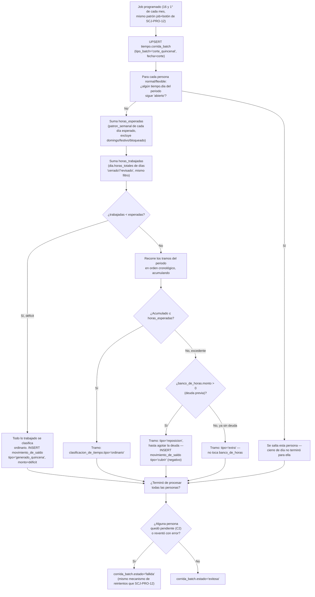

# Proceso — Corte quincenal

**Sistema de Control de Jornada**
Folio SCJ-PRO-13 · Versión 1.1 · 21 de octubre de 2026

Séptimo `SCJ-PRO` del subsistema de **Tiempo**. Cubre, en un solo documento, el corte de banco de
horas (`generado_quincena`, `SCJ-DEC-02`) **y** la clasificación de tiempo por tramo
(`clasificacion_de_tiempo.tipo`) — combinados a propósito: reposición sólo se puede determinar
sabiendo si la persona tenía deuda, y eso sólo se sabe al momento del corte.

---

## I. Alcance

**Cubre:** desde que un periodo quincenal termina, hasta que cada persona `normal`/`flexible`
queda con su `clasificacion_de_tiempo` completa por tramo del periodo, y su `banco_de_horas`
actualizado si hubo déficit.

**No cubre:**

- Jornada `de_confianza` — por diseño no maneja horas extra ni banco de horas (`SCJ-ESP-01 §VI.3`),
  queda fuera de este corte por completo.
- Resolución manual del saldo (`cubrir`/`arrastrar`/`descontar`/`condonar` que decide RH) — es un
  proceso de aplicación aparte, no un batch.
- Qué pasa si se corrige una marca **después** de que su periodo ya cerró — `SCJ-PRO-10` recalcula
  el tramo, pero no reabre un corte quincenal ya hecho. Pendiente de decidir aparte.

---

## II. Precondiciones

1. **Cierre de día ya corrió para todo el periodo** (`SCJ-PRO-12`). Si alguna persona tiene un
   `tiempo.dia` todavía `abierto` dentro del rango, esa persona se salta este corte — no se puede
   calcular sin saber el estado real de todos sus días. Un día `bloqueado` **no** cuenta como
   pendiente: se excluye del cálculo (§V), no bloquea a la persona.
2. Existe `tope_legal` y `patron_semanal` vigentes para calcular horas esperadas.

---

## III. Diagrama de flujo — estado objetivo

---

## IV. Descripción paso a paso

| Paso | Actor | Acción | Toca |
|---|---|---|---|
| A1/B1 | Sistema | Job programado + botón manual, misma invocación (mismo mecanismo de `SCJ-PRO-12`) | `tiempo.corrida_batch` |
| C1/C2 | Sistema | Salta a cualquier persona con un día todavía `abierto` en el periodo — no se puede calcular sin cierre de día completo | `tiempo.dia` |
| D1/D2 | Sistema | Suma horas esperadas y trabajadas del periodo, excluyendo domingo/festivo/`bloqueado` de ambos lados | `tiempo.dia`, `tiempo.patron_semanal` |
| E1/F1 | Sistema | Déficit: todo lo trabajado es `ordinario`, el faltante genera deuda | `tiempo.clasificacion_de_tiempo`, `tiempo.movimiento_de_saldo` |
| G1/H1/H2 | Sistema | Sin déficit: recorre tramos en orden, cada uno `ordinario` mientras el acumulado no rebase lo esperado | `tiempo.clasificacion_de_tiempo` |
| I1/I2 | Sistema | Excedente con deuda previa: `reposicion`, reduce `banco_de_horas` vía `movimiento_de_saldo` tipo `cubrir` | `tiempo.clasificacion_de_tiempo`, `tiempo.movimiento_de_saldo` |
| I3 | Sistema | Excedente sin deuda: `extra`, sin tocar el banco de horas — es obligación de pago aparte | `tiempo.clasificacion_de_tiempo` |
| K1-K3 | Sistema | Mismo criterio de éxito/falla que `SCJ-PRO-12`: una persona pendiente o un error no detiene a las demás | `tiempo.corrida_batch` |

---

## V. Reglas de negocio confirmadas

- **Periodos fijos: días 1-15 y 16-30 de cada mes.** Si el mes tiene menos de 30 días (febrero), el
  segundo periodo cierra en el último día real (28 o 29). **Si el mes tiene 31 días, el día 31 no
  cierra su propio periodo — se cuenta en el periodo siguiente** (el `[1,15]` del mes que entra,
  que en la práctica arranca desde ese día 31).
- **Un día `bloqueado` no bloquea a la persona, se excluye del cálculo** — ni cuenta como esperado
  ni como trabajado, en ninguno de los dos lados de la resta. Consistente con `SCJ-ESP-01 V2.1
  §VI.2`: no se sabe su valor real hasta `revisado`, así que no se usa ninguno todavía.
- **Un día `abierto` sí bloquea — a la persona, no al corte completo.** Significa que el cierre de
  día no terminó para ella; se salta esta corrida y se reintenta con el mismo mecanismo de
  `SCJ-PRO-12`.
- **Clasificación por tramo, cronológica, acumulada dentro del periodo** — no por día ni por
  proporción. El mismo tramo nunca se parte entre dos clasificaciones.
- **Orden de clasificación: ordinario → reposición (si hay deuda) → extra (si no hay o ya se
  agotó).** Reposición nunca rebasa la deuda existente — el resto, si sobra, es extra.
- **Déficit de periodo: todo lo trabajado es ordinario**, sin excepción — el faltante es lo único
  que genera `movimiento_de_saldo`, nunca al revés (no hay clasificación negativa por tramo).
- **`extra` nunca toca `banco_de_horas`** — es la regla ya cerrada de "no hay saldo a favor"
  (`SCJ-ESP-01 §VI.6`): el excedente sin deuda se resuelve como pago en el momento, no se acumula.
- **`reposicion` se registra como `movimiento_de_saldo` tipo `cubrir`, con `monto` negativo** —
  mismo disparador ya existente (`fn_movimiento_de_saldo_actualiza_banco`) resta el monto del
  saldo, sin lógica nueva de banco de horas.
- **Misma orquestación que `SCJ-PRO-12`**: job programado + botón manual, misma invocación,
  `tiempo.corrida_batch` (`tipo_batch='corte_quincenal'`, ya contemplado en el `CHECK`), idempotente
  por persona.

---

## VI. Estado actual al emitir V1.0 — nada construido todavía (el estado vigente está en VIII)

**Sin cambios de esquema** — `clasificacion_de_tiempo.tipo` (`ordinario`/`reposicion`/`extra`) y
`movimiento_de_saldo.tipo` (`generado_quincena`/`cubrir`) ya existían con los valores correctos;
`corrida_batch.tipo_batch` ya incluía `corte_quincenal`. Este documento sólo diseña el algoritmo
que los usa. Falta:

1. **El batch en sí** — mismo criterio que `SCJ-PRO-12`: es la otra pieza de más riesgo del
   subsistema (afecta directamente banco de horas y clasificación de pago), se construye con
   pruebas reales.
2. Job programado (mismo mecanismo de `SCJ-PRO-12`, corre el 1° y el 16°) + botón manual.
3. RLS de `tiempo.clasificacion_de_tiempo`/`movimiento_de_saldo`/`banco_de_horas` — no existen.

---

## VII. Siguiente paso

Con `SCJ-PRO-07` a `13`, el subsistema de Tiempo tiene 7 procesos documentados — cierre de día y
corte quincenal, los dos batches de mayor riesgo, comparten la misma orquestación y probablemente
conviene implementarlos juntos. Queda: el batch de jornada `de_confianza` (el más simple e
independiente de los dos anteriores).

---

## VIII. Actualización posterior (V1.1, 21-oct-2026): ausencias neutras, periodo aplicado y compensación

El corte de 01–15-oct-2026 cargó 86 h de deuda a una persona con 13 permisos con goce autorizados. Tres causas y su corrección (migraciones `118_` a `120_`, aplicadas en la base real el 20 y 21 de octubre de 2026):

1. **Los días de ausencia no tienen tramos.** El corte sumaba las horas trabajadas solo de `tiempo.tramo`. Decisión: en los días sin tramos el corte cuenta `tiempo.dia.horas_totales` como trabajadas (cambio de backend, `corte_quincenal.py`).
2. **La jornada neta de la ausencia no coincidía con la esperada.** `fn_ausencia_resuelve_excepcion` (`66_`) restaba el parámetro global `descuento_pausa_no_registrada_min`; el corte espera `hora_salida − hora_entrada − minutos_comida` por fila de `patron_semanal`. `118_` la alinea con el corte (por fila, así también con jornada partida). El descuento global queda solo para `cierre_dia` en días de 2 marcas. Redondeo: `horas_totales` es `numeric(5,2)`; backend redondea las esperadas por día a 2 decimales.
3. **La idempotencia dependía de los tramos clasificados.** Un periodo sin tramos se podía aplicar dos veces y duplicar la deuda. `119_` agrega `tiempo.corte_quincenal_aplicado` (`UNIQUE (persona_id, periodo_desde)`, también para periodos con resultado 0) y cambia la firma de `fn_corte_quincenal_aplicar_persona`: recibe el periodo y las horas, lo registra en la misma transacción y rechaza un duplicado con `ERRCODE SCJ23`, `HINT 'periodo_ya_aplicado'`. La firma anterior se elimina.

**Compensación de un `generado_quincena` erróneo** (`120_`): nuevo tipo `compensacion` en `movimiento_de_saldo`, ligado al original por `compensa_movimiento_id` (una sola compensación por movimiento, monto exacto en negativo, motivo y autor obligatorios), mediante el RPC `fn_movimiento_de_saldo_compensar` y el permiso no heredable `movimiento_de_saldo_compensar`. El trigger de `fn_movimiento_de_saldo_actualiza_banco` mueve el saldo; no se compensa si el saldo quedaría negativo (también validado en el trigger, con el banco bloqueado, por cualquier camino de escritura), nadie compensa movimientos de su propio banco (`compensacion_propia`) y el motivo admite a lo más 500 caracteres. El desglose por antigüedad (`backend/app/banco_antiguedad.py`) debe tratar la compensación contra el lote ligado, no por FIFO.

La corrección de datos de la persona afectada (recalcular las horas de sus días de ausencia con goce, compensar las 86 h y registrar el periodo con resultado 0) se ejecutó el 20-oct-2026 con autorización explícita; el script vive en `db/correcciones/` y verifica antes de escribir que el periodo no tenga ningún día elegible que no sea ausencia con goce, que ningún día tenga tramos y que las horas esperadas recalculadas cuadren.

**Precisiones de la implementación.**

- **Idempotencia:** `fn_corte_quincenal_aplicar_persona` recibe el periodo, las horas esperadas y las trabajadas, lo registra en `tiempo.corte_quincenal_aplicado` (`UNIQUE (persona_id, periodo_desde)`, también para un resultado 0) en la misma transacción y devuelve `SCJ23` / `periodo_ya_aplicado` si ya existía; la guarda antigua por tramos clasificados se conserva para los periodos previos a `119_`. Acepta clasificaciones y movimientos vacíos.
- **Horas trabajadas de los días sin tramos:** el corte suma `horas_totales` de los días sin tramos (ausencias con goce, vacaciones, incapacidad) y los minutos de los tramos en los demás. Las esperadas de cada día se **redondean a 2 decimales antes de sumar**, porque `dia.horas_totales` es `numeric(5,2)`; así un permiso queda neutro al centésimo.
- **Compensación:** el RPC `fn_movimiento_de_saldo_compensar` exige el permiso `movimiento_de_saldo_compensar` (no heredable; Gerente General y TI), un motivo de hasta 500 caracteres y no permite compensar un movimiento del banco propio (`SCJ24` / `compensacion_propia`) ni dejar el saldo por debajo de 0 (`saldo_insuficiente`, validado también en el trigger, con el banco bloqueado). El desglose por antigüedad de `banco_antiguedad.py` trata una compensación contra el lote ligado, no por FIFO.
- **Ausencias que alimentan el corte:** una ausencia resuelta no cambia de tipo (`121_`, `SCJ25`), nadie resuelve la propia (`122_`, `SCJ26`) y nadie edita el tipo de su propia ausencia pendiente; un permiso con goce no se puede inflar sin una aprobación ajena.
- **Prevención:** si un día elegible del periodo no tiene fila de `tiempo.dia` (típicamente una falta pendiente), el corte de esa persona devuelve `pendiente_dia_abierto` hasta que alguien la resuelva.

---

*Proceso · Folio SCJ-PRO-13 · V1.1*
